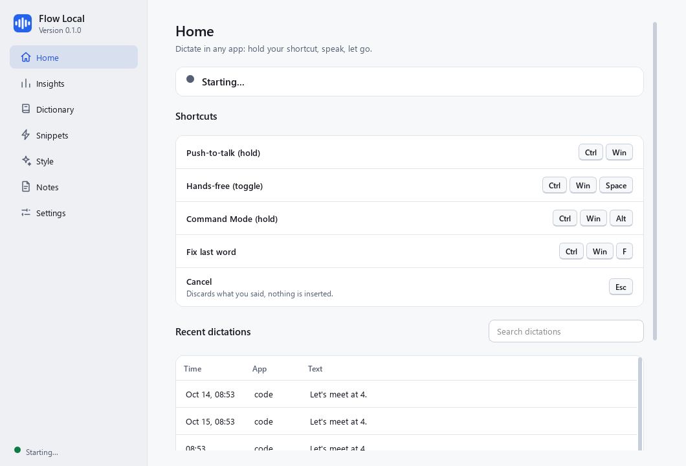

# Flow Local

Free, fully offline voice dictation for Windows. Hold a shortcut, speak in Arabic, English or a mix of both, and clean, formatted text appears at your cursor in any app: browsers, VS Code, chat boxes, Word, WhatsApp Web.

It follows the workflow of cloud dictation tools, but everything runs on your computer:

- **Speech to text:** [faster-whisper](https://github.com/SYSTRAN/faster-whisper) (OpenAI Whisper). `large-v3-turbo` on an NVIDIA GPU, `small` on CPU.
- **Cleanup:** a small local language model through [Ollama](https://ollama.com) (`qwen2.5:7b-instruct`, fallback `qwen2.5:3b`), with a rule-based layer that works even when Ollama is off.
- **UI:** PySide6 (Qt). A small always-on-top bar, a main window ("Hub") and a tray icon.
- **Storage:** SQLite on your machine. Audio is never saved.

Flow Local is an independent personal tool. It uses its own name, icons and design.



> **Built with AI.** This project was implemented by **Claude Sonnet 5.5** (Anthropic). Expect rough edges on some hardware setups. Issues and fixes are welcome.

## Privacy

Nothing leaves your computer. The only network use is the **one-time speech model download**, which happens only when you press *Download now* in Settings > Models (or run `transcribe`/`bench` from the command line). Ollama is contacted only on `127.0.0.1`. The app refuses to talk to any other LLM host. Checked while running: no open network connections.

## Setup

Requirements: **Windows 10 or 11**, **Python 3.11 or 3.12**, a microphone, and about 6 GB of free disk space for the models. An NVIDIA graphics card makes it much faster but is not required.

### Quick start

```powershell
git clone https://github.com/Fable-11/flow-local.git
cd flow-local
.\scripts\setup.ps1
```

The script creates a virtual environment, installs everything (including the NVIDIA GPU libraries only if it finds an NVIDIA card), pulls the right cleanup model if Ollama is installed, and prints a report of your computer. Useful switches: `-NoCuda`, `-SkipOllama`, `-DownloadModel` (also fetch the speech model now), `-Check` (install nothing, just report).

Then start the app:

```powershell
.\.venv\Scripts\python.exe -m flow
```

On first run the Hub opens. If the speech model is not downloaded yet, go to **Settings > Models** and press **Download now** (about 1.6 GB for the big model, 0.5 GB for the small one). This is the only time the internet is used; afterwards everything works offline.

### Manual install

```powershell
py -3.12 -m venv .venv
.\.venv\Scripts\python.exe -m pip install -e ".[cuda]"    # drop [cuda] if you have no NVIDIA graphics card
```

Optional but recommended: [Ollama](https://ollama.com) for smarter cleanup and Command Mode. Without it, cleanup uses built-in rules and Command Mode is unavailable.

```powershell
winget install Ollama.Ollama
ollama pull qwen2.5:7b-instruct      # use qwen2.5:3b on a laptop without an NVIDIA card
```

Check your setup at any time with `.\.venv\Scripts\python.exe -m flow doctor`.

### Which computer am I?

Flow Local looks at your hardware on first run and picks the defaults. You can change all of it in Settings.

| Your computer | Speech model | Cleanup model | Typical delay per dictation |
|---|---|---|---|
| Desktop or laptop with an NVIDIA GPU (8 GB or more) | `large-v3-turbo` on the GPU | `qwen2.5:7b-instruct` | under 1.5 s |
| No NVIDIA GPU (most thin laptops) | `small` on the CPU | `qwen2.5:3b` | about 3 to 4 s |
| 8 GB of memory or less | as above | `qwen2.5:3b` | models unload after 2 idle minutes |

Everything is stored per computer (settings, dictionary, history), so a laptop starts with its own fresh copy. Move your dictionary between computers with **Dictionary > Export / Import**.

### Start at login and desktop shortcuts

In the Hub: **Settings > Startup**. Tick *Launch Flow Local when I sign in to Windows*, and press *Create desktop shortcuts*. Or from the command line:

```bash
.venv\Scripts\python -m flow install-shortcuts
```

This puts two icons on your desktop:

- **Flow Local** (blue icon with a sound wave): opens the app. If it is already running (for example it started at login and lives in the tray), it just opens the window. The same entry is added to the **Start menu**, so you can find it with Windows search or pin it to the taskbar.
- **Stop Flow Local** (red icon with a stop square): stops the app completely. You can also right-click the tray icon and choose *Quit*, or *Pause dictation* to keep it running but silent.

At login the app starts quietly in the tray with no window.

### Portable build

```powershell
.\scripts\build.ps1            # includes CUDA libraries (large, about 3 GB)
.\scripts\build.ps1 -NoCuda    # CPU-only, much smaller
```

This produces `dist\FlowLocal\FlowLocal.exe` (windowless) and `dist\FlowLocal\flow-cli.exe` (console, for `doctor`, `clean`, `dict`, ...). Copy the whole folder anywhere.

## Shortcuts

All shortcuts can be changed in Settings > Shortcuts (type them or press **Record**). Duplicates are rejected with a warning. Mouse buttons work too (`mouse_x1`, `mouse_x2`, `mouse_middle`).

| Action | Default | What it does |
|---|---|---|
| Push-to-talk | hold **Ctrl+Win** | Speak while holding, text is inserted on release |
| Hands-free | **Ctrl+Win+Space** (or double-tap Ctrl+Win) | Starts recording; press again to stop |
| Command Mode | hold **Ctrl+Win+Alt** | Edit the selected text by voice |
| Fix last word | **Ctrl+Win+F** | Teach the dictionary from a correction |
| Cancel | **Esc** | Discards the current dictation, nothing is inserted |

The Flow Bar at the bottom of the screen shows what is happening: a waveform while recording (red dot = push-to-talk, blue = hands-free, purple = Command Mode), a spinner while processing, then a check mark or a short error.

## Using it

**Dictation.** Hold the shortcut, speak naturally, release. Filler words ("um", "uh", "يعني") are removed, self-corrections are resolved ("meet at 3, no wait, 4" becomes "meet at 4"), punctuation and capitalization are added, and spoken lists become numbered lists. Say "new line" or "new paragraph" (or "سطر جديد" / "فقرة جديدة") for line breaks, and "question mark", "comma", and at the end "period" for punctuation.

**Command Mode.** Select text in any app (not in terminals), hold Ctrl+Win+Alt and say what to do: "make this more formal", "translate to Arabic", "turn into bullets", "summarize in one sentence". The selection is replaced. Press **Ctrl+Z** in the app to undo.

**Dictionary.** Add names and jargon ("Kubernetes", "NASA", "faster-whisper"). Starred words get priority. Optionally add a *spoken form* ("cuber nettys") that is replaced by the written word. The dictionary is sent to Whisper as a prompt and to the cleanup model as a glossary. Import and export JSON or CSV. The dictionary also learns on its own: a name or term that shows up in three separate dictations is added automatically (shown in grey, delete it and it never returns), recently used words go first, and learned words you stop using fade out after 90 days. Only single words are stored, never your sentences. Turn it off in Settings > Cleanup.

**Product names.** Well-known names are fixed from context, for example "cloud" becomes "Claude" when you say "ask cloud", "cloud code" or mention Anthropic, while "cloud storage" stays as it is. Also ChatGPT, OpenAI, GitHub and VS Code.

**Fix last word.** After a misrecognized word, fix it in the app, select the corrected word, press Ctrl+Win+F. Flow Local offers to add it to the dictionary.

**Snippets.** Say a trigger phrase on its own ("my email") to insert saved text exactly as written. Tick *also expand inside longer sentences* for triggers you only say on purpose.

**Style.** Pick Default, Formal, Casual, Excited or Very casual, add your own instructions, and set per-app rules (for example Casual in WhatsApp). Chat apps default to casual and email apps to formal.

**Notes, History, Insights.** The Notes page is a scratch pad you can dictate into. Home lists recent dictations (copy, re-run cleanup, delete). Insights shows words dictated, speed, time saved and your streak. History can be turned off or auto-deleted after N days in Settings > Privacy.

**Sounds.** A soft rising "bloop" plays when recording starts and a falling one when it stops (a gentle low two-note fall on errors). Settings > Display and sound lets you pick the style (*Soft bloop*, *Short pop*, or *Windows speech chime*, which reads the speech-recognition sounds that ship with Windows and softens them) and the volume; changing the style plays a preview. From the command line: `flow sound start --style pop --volume 40`. Turn them off or change the volume in Settings > Display and sound. The start tone is blanked out of the recording, so the speakers' beep is never transcribed.

**Several monitors.** The Flow Bar appears on every screen by default. Settings > Display and sound can limit it to the screen where your mouse pointer is. Plugging in or removing a monitor is handled live.

**Memory.** Settings > Memory: *Balanced* (default) unloads the speech model after 10 idle minutes and the AI model after 5; *Lowest memory* after 2; *Fastest* keeps both loaded. A model is reloaded the moment you press the shortcut, while you are still speaking, so you rarely notice (the first dictation after a long break can take about 2 seconds longer). While idle, Flow Local also hands unused memory back to Windows, which takes Task Manager's figure from several hundred MB to a few MB. Ollama's own `llama-server` process shows up separately in Task Manager.

**Speaking far from the microphone.** Settings > Microphone > *Automatic volume boost* (on by default) measures each recording and, when it is quiet, filters low rumble, reduces background noise a little and raises the level (up to 100x) before transcribing. Speech down to about 40 dB below a normal level works if the room is quiet; the Flow Bar tells you when a recording is too quiet or the microphone looks muted. Run `flow mic` to test your microphone at the distance you sit: it prints the level, the noise, and what Flow Local will do.

**Whisper mode.** Settings > Microphone > Whisper mode boosts quiet speech.

**Experimental.** "Press enter" at the end of a dictation presses the Enter key (off by default).

## Where things live

| What | Where |
|---|---|
| Database (history, dictionary, snippets, notes, settings) | `%LOCALAPPDATA%\FlowLocal\flow.db` |
| Logs | `%LOCALAPPDATA%\FlowLocal\logs\flow.log` (and `crash.log`) |
| Speech models | the Hugging Face cache, `%USERPROFILE%\.cache\huggingface\hub` |
| Launch at sign-in | `HKCU\Software\Microsoft\Windows\CurrentVersion\Run` (toggle in Settings > Startup) |

## Troubleshooting

| Problem | Fix |
|---|---|
| Bar says "Speech model not downloaded" | Settings > Models > Download now (one-time internet use). |
| Nothing is inserted in an app | Run Flow Local at the same privilege level as that app. Windows blocks a normal program from typing into an "Administrator" window. |
| Start menu opens when I release Win | It should not (Flow Local cancels it). If another tool also hooks the Win key, close it or change the shortcut. |
| Shortcut does nothing | Check Settings > Shortcuts for conflicts. Run `flow doctor`. Security software can block keyboard hooks; check the log. |
| "No microphone found" | Plug it in or choose it in Settings > Microphone. Check Windows privacy settings allow desktop apps to use the microphone. |
| It does not hear me from far away | Leave *Automatic volume boost* on (Settings > Microphone), raise the microphone level in Windows (Settings > System > Sound > Input), and run `flow mic` to see the level. Speech buried in noise cannot be recovered: move closer or reduce the noise. |
| Words missing at the start/end | Speak right after pressing and release after the last word. Whisper mode helps with quiet speech. |
| Cleanup is basic / Command Mode says Ollama is not running | Start Ollama (`ollama serve`) and check the models with `ollama list`. Settings > Models shows the status. |
| No sound cues | Settings > Display and sound: tick the sound option and press Test. Check Windows' sound output device and volume. |
| Bar only on one monitor | Settings > Display and sound > Show the Flow Bar on: All screens. |
| Slow first dictation after a break | Memory mode unloaded the models. Choose *Fastest* in Settings > Memory to keep them loaded. |
| Slow on CPU | Use a smaller model (Settings > Models). A GPU with `large-v3-turbo` is about 10x faster. |
| Command Mode refuses | It is disabled in terminals (Ctrl+C would interrupt programs) and needs a real selection. |
| Text pasted with a leading space | Dictations in the same window within two minutes are joined with a space. Dictate into a new window to avoid it. |

Logs are the first place to look: `%LOCALAPPDATA%\FlowLocal\logs\flow.log`.

## How it works

```
hotkey (low-level keyboard/mouse hook)
   -> record 16 kHz audio (mic stays open with a 0.5 s pre-roll so first words are kept)
   -> Silero VAD trims silence
   -> faster-whisper transcribes (dictionary words as initial prompt, language auto-detected)
   -> snippet match?  yes: insert saved text verbatim
   -> dictionary replacements
   -> rules: spoken commands, fillers, numeric self-corrections
   -> local LLM cleanup (Ollama) with tone, app and glossary context
   -> safety checks: reject output that answers, translates or invents content
   -> rules: spacing, Arabic punctuation, lists, capitalization
   -> paste at the cursor (clipboard saved and restored), or type characters as a fallback
```

Details worth knowing:

- **Hotkeys** use a ctypes low-level hook so modifier-only holds like Ctrl+Win work, and a dummy key stops the Start menu from opening when Win is released. The hook ignores synthetic keys, so Flow Local's own paste never triggers itself.
- **Insertion** saves your clipboard, pastes with Ctrl+V, then restores it (only if nothing else changed it meanwhile). A journal on disk restores the clipboard even if the app crashes mid-paste. Pastes are hidden from Windows clipboard history.
- **The LLM never gets to answer you.** The transcript is wrapped in tags with strict rules, and the output is validated. If it looks like an answer, a translation or invented text, the rule-based result is used instead.
- **Fast:** models stay loaded, the LLM is kept warm (`keep_alive`), and the GPU gets a warm-up decode at start-up. Measured on a mid-range NVIDIA GPU: model load 2 s, cleanup about 0.4 s, idle CPU about 0.7% of one core from source (about 1.7% for the packaged build).
- **Threads:** Qt UI on the main thread, hotkeys on the hook thread, audio on the audio callback thread, dictation on a worker thread.

See `DECISIONS.md` for every design decision and why it was made.

## Development

```bash
.venv\Scripts\python -m pytest -q -m "not slow and not llm"   # fast tests
.venv\Scripts\python -m pytest -q                               # everything (needs desktop, GPU, Ollama)
.venv\Scripts\python -m pytest -q -m llm                        # real-LLM cleanup/command tests
.venv\Scripts\python -m ruff check .
```

Layout: `src/flow/{audio,stt,cleanup,hotkeys,insert,store,ui}`, tests in `tests/` (cleanup fixtures in `tests/fixtures/cleanup`).

CLI helpers: `flow transcribe`, `flow bench`, `flow doctor`, `flow clean "text"`, `flow dict ...`, `flow snippet ...`.

## License

Flow Local is released under the [MIT License](LICENSE). It builds on open-source software and open models, listed with their licenses in [THIRD_PARTY_NOTICES.md](THIRD_PARTY_NOTICES.md). The AI models are **not** part of this repository: they are downloaded separately and have their own licenses (the 3B Qwen model's terms may restrict commercial use). If you publish a packaged build, read the notes about Qt (LGPL) and the NVIDIA libraries first.

## Known limitations

- Whisper picks one language per audio segment, so very fast switching inside one sentence is best-effort.
- Windows blocks input from a normal program into elevated (Administrator) windows.
- Command Mode needs Ollama and is unavailable in terminals. In editors that copy the whole line when nothing is selected, make sure text is selected.
- "Ctrl+Win+<other key>" shortcuts of Windows (such as switching virtual desktops) briefly start a dictation that is cancelled immediately.
- Chrome, VS Code and terminal insertion are supported through standard paste; only the Tk test window was verified automatically.
